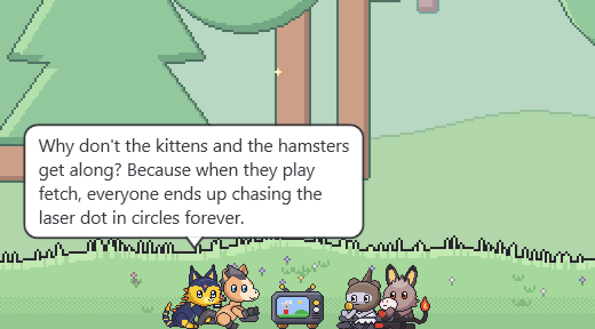
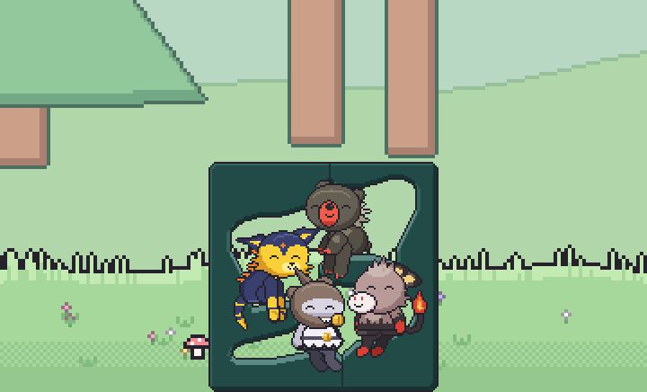

# DesktopPet

A Shimeji-style desktop pet for Windows. Small pixel-art critters live on your desktop: they walk along the taskbar,
climb and ride your windows, nap on furniture, play video games together, chat with each other and leave you sticky
notes.

Built in C# / .NET 10 / WPF


## Features

- **Lives on your desktop:** transparent, click-through, always-on-top pets with gravity, landing on the taskbar and
  window tops, and support for multiple monitors and mixed DPI.
- **Uses your windows:** pets stand on windows and ride them when they move, climb window sides and screen edges,
  perch on title bars, and can push windows around (you can switch this off).
- **Drag and throw:** pick a pet up with the mouse and throw it. It bounces off walls and skids when it lands.
- **Needs and care:** each pet has hunger, happiness and energy. Feed, play with or tuck in a pet from its menu.
  Progress is saved.
- **Reading the screen (optional):** pets can read the text on the window they're near using the OCR built into
  Windows, and comment on it. This stays on your PC, and password managers, sign-in prompts and private browsing
  windows are excluded by default.

## Screenshots

**Climbing and riding windows.** Pets stand on window tops and climb window sides.


**Speech bubbles and sticky notes.** All the text comes from the local model: jokes and banter between pets, and
notes stuck to the window.


**Furniture.** Pets look after themselves: a nap in the bed, a snack at the trough, video games at the TV and a doze
on the couch.


**Video games together.** When one pet starts a game, nearby pets come over and join in, up to four at the TV.



**The Living Tower.** A four-level lounge: pets sit on its shelves and in its niche, facing each other, and drop by
to join friends who are already hanging out there.



**Eggs and babies.** Two happy pets court each other (left), and a moment later there's an egg (right).


**Death and gravestones.** A neglected pet leaves a gravestone with its name and dates.


**The menu and the debug overlay.** Right-click a pet for its stats and care options. The debug overlay shows the
floors, window tops, walls and what each pet and piece of furniture is doing.

<p>
  
</p>


The screenshots are staged with `tools/demo/` on a pixel-art forest backdrop; see
[docs/how_to_make_demo.md](docs/how_to_make_demo.md).

## Requirements

- Windows 10 (version 2004 / build 19041) or later
- [.NET 10 SDK](https://dotnet.microsoft.com/) to build. The published single-file exe doesn't need .NET installed.
- Optional, for chat: about 1.5 GB of disk space for the model and 1.5–2 GB of video memory or RAM. It runs on the
  GPU through Vulkan if you have a usable card, and on the CPU otherwise.

## Getting started

```powershell
dotnet build DesktopPet.slnx
dotnet test DesktopPet.slnx

# Optional: download the chat model into models\ (the build copies it next to the exe)
.\tools\models\get-model.ps1
```

The app is built to `src/DesktopPet.App/bin/Debug/net10.0-windows10.0.19041.0/DesktopPet.App.exe`.

In VS Code, press **F5** to run with the debugger, or use the tasks `build`, `test`, `watch tests`, `run` and
`publish`. The `publish` task builds a self-contained single-file `publish/DesktopPet.App.exe`.

Only one copy runs at a time, and a running pet locks `bin/`, so quit it (**Exit** in the menu) before rebuilding.
Without the model file the pets still work; they just don't talk.


| Doc | What's in it |
|---|---|
| [docs/PLAN.md](docs/PLAN.md) | Architecture, milestone status, known limitations and plans |
| [docs/CODEMAP.md](docs/CODEMAP.md) | What every file does, how a frame flows, recipes for common changes |
| [docs/CHAT.md](docs/CHAT.md) | Speech bubbles, sticky notes, screen reading, the model and their settings |
| [docs/FURNITURE.md](docs/FURNITURE.md) | The built-in furniture and how to make your own |
| [docs/SPRITES.md](docs/SPRITES.md) | Custom sprite sheets, `atlas.json` and the list of animations |
| [docs/SPRITE_GENERATOR.md](docs/SPRITE_GENERATOR.md) | How the built-in rabbit art is generated |
