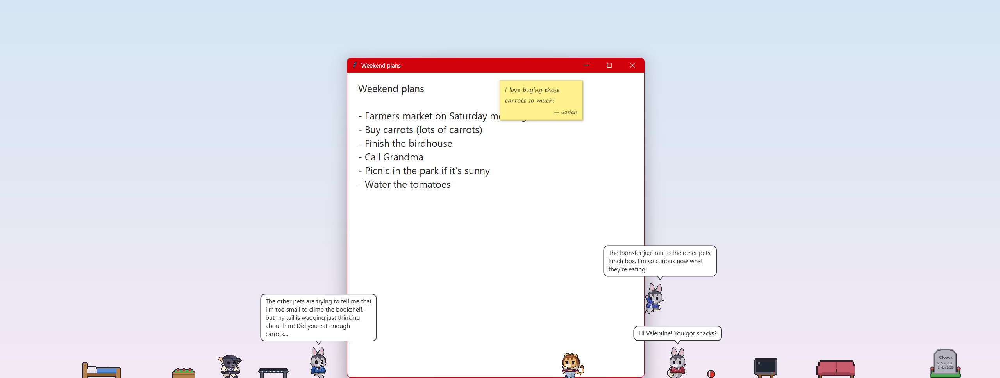
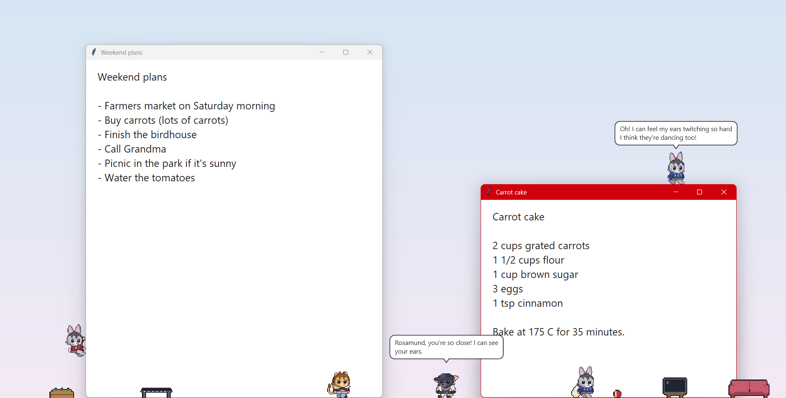
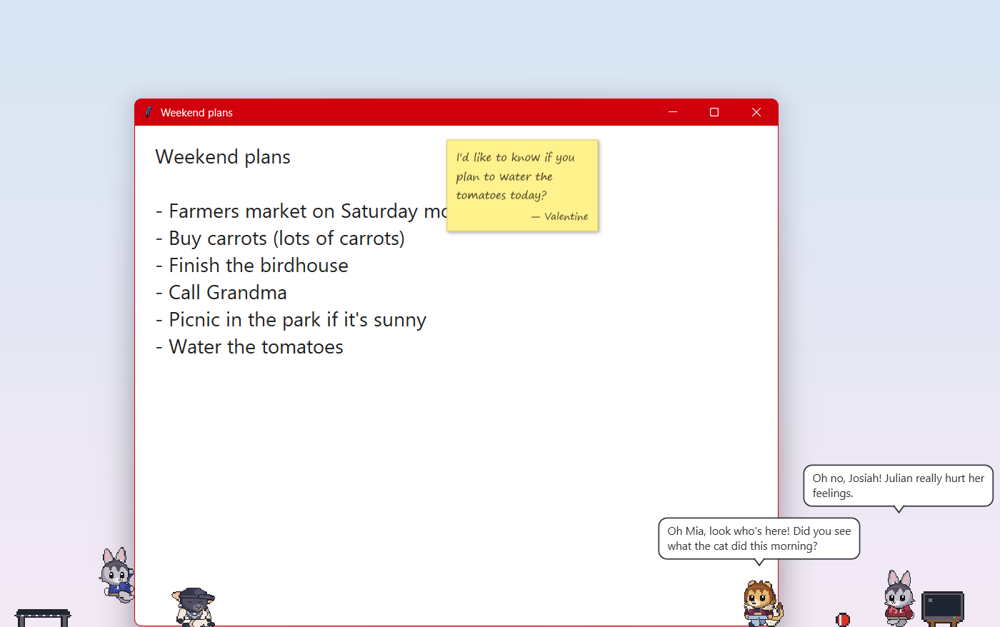
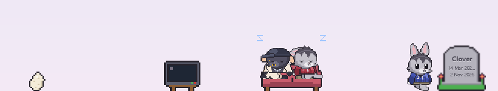
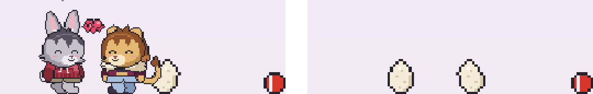
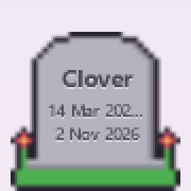
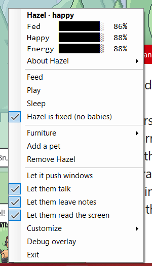
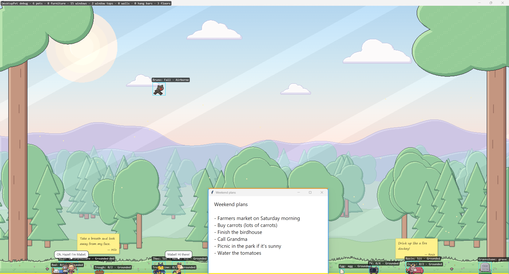

# DesktopPet

A Shimeji-style desktop pet for Windows. Small pixel-art rabbits live on your desktop: they walk along the taskbar,
climb and ride your windows, nap on furniture, chat with each other and leave you sticky notes. All of the words come
from a small language model that runs on your own PC.

Built in C# / .NET 10 / WPF, and structured like a small 2D game: a fixed 60 Hz loop, a behavior state machine and
sprite animation.



## Features

- **Lives on your desktop:** transparent, click-through, always-on-top pets with gravity, landing on the taskbar and
  window tops, and support for multiple monitors and mixed DPI.
- **Uses your windows:** pets stand on windows and ride them when they move, climb window sides and screen edges,
  perch on title bars, and can push windows around (you can switch this off).
- **Drag and throw:** pick a pet up with the mouse and throw it. It bounces off walls and skids when it lands.
- **Needs and care:** each pet has hunger, happiness and energy. Feed, play with or tuck in a pet from its menu.
  Progress is saved.
- **Multiple pets:** up to 8, each with its own name, neediness, personality and (optionally) its own sprites.
- **Furniture:** a ball, TV, couch, trampoline, bed, play pen and trough. Pets use them on their own when they need
  to. You can add your own furniture as JSON files and images. See [docs/FURNITURE.md](docs/FURNITURE.md).
- **Eggs and babies:** now and then two happy pets standing together court each other and lay an egg. It hatches
  into a child that takes after both parents: its numbers, a blend of their jacket colours, and one parent's
  sprites. Pets can be fixed from the menu so they don't breed.
- **Death and gravestones:** a pet neglected for too long while you're at the PC dies (you're warned first, and time
  away never counts). It leaves a gravestone with its name and dates; right-click it to revive the pet or delete it.
  This can be switched off in `settings.json`.
- **Speech bubbles and sticky notes:** pets talk about their needs, banter with each other, tell jokes, react to
  clicks and stick notes on the window they're standing on. The text comes from a local model (Qwen3.5-2B via
  LLamaSharp), and nothing is sent anywhere. See [docs/CHAT.md](docs/CHAT.md).
- **Reading the screen (optional):** pets can read the text on the window they're near using the OCR built into
  Windows, and comment on it. This stays on your PC, and password managers, sign-in prompts and private browsing
  windows are excluded by default.
- **Customizable:** a live-reloading `settings.json`, custom sprite sheets (export the built-in rabbit as a template
  and paint over it), and per-pet traits and personality files. See [docs/SPRITES.md](docs/SPRITES.md).

## Screenshots

**Climbing and riding windows.** Pets stand on window tops and climb window sides.



**Speech bubbles and sticky notes.** All the text comes from the local model: banter between pets, and a note stuck
to the window.



**Furniture.** A rabbit plays ball in front of the TV while two others nap on the couch.



**Eggs and babies.** Two happy pets court each other (left), and a moment later there's an egg (right).



**Death and gravestones.** A neglected pet leaves a gravestone with its name and dates.



**The menu and the debug overlay.** Right-click a pet for its stats and care options. The debug overlay shows the
floors, window tops, walls and what each pet and piece of furniture is doing.

<p>
  
</p>



## Requirements

- Windows 10 (version 2004 / build 19041) or later
- [.NET 10 SDK](https://dotnet.microsoft.com/) to build. The published single-file exe doesn't need .NET installed.
- Optional, for chat: about 1.5 GB of disk space for the model and 1.5–2 GB of video memory or RAM. It runs on the
  GPU through Vulkan if you have a usable card, and on the CPU otherwise.

## Getting started

```powershell
dotnet build DesktopPet.slnx
dotnet test DesktopPet.slnx

# Optional: download the chat model into models\ (the build copies it next to the exe)
.\tools\models\get-model.ps1
```

The app is built to `src/DesktopPet.App/bin/Debug/net10.0-windows10.0.19041.0/DesktopPet.App.exe`.

In VS Code, press **F5** to run with the debugger, or use the tasks `build`, `test`, `watch tests`, `run` and
`publish`. The `publish` task builds a self-contained single-file `publish/DesktopPet.App.exe`.

Only one copy runs at a time, and a running pet locks `bin/`, so quit it (**Exit** in the menu) before rebuilding.
Without the model file the pets still work; they just don't talk.

## Using it

Right-click a pet, or the tray icon, to open the menu. It shows the pet's name, mood and stats, and has:

- **Feed / Play / Sleep** to care for the pet
- **Add a pet / Remove pet**
- **Furniture:** add each kind beside the pet, or remove it all
- Switches for **Let it push windows**, **Let them talk**, **Let them leave notes** and **Let them read the screen**
- **Customize:** edit settings, open the data folder, export a sprite template
- **Debug overlay:** shows the floors, platforms and walls the pets see

Settings, saves, sprites, furniture and per-pet files live in the `data` folder (the repo root when run from a build inside the repo, otherwise next to the exe; old AppData data is copied over on first run). Edits there apply as soon
as you save the file. Any problems show up in a notification and in `problems.txt`.

## Project layout

```
src/DesktopPet.Core              All game logic (physics, behavior, stats, chat scheduling). No WPF or Win32 references.
src/DesktopPet.Platform.Windows  Thin Win32 adapter (CsWin32) and Windows OCR
src/DesktopPet.Chat              The local language model via LLamaSharp
src/DesktopPet.App               WPF app: windows, game loop, menu, tray, customization
tests/DesktopPet.Core.Tests      xUnit tests for Core, run against a fake desktop
tools/sprites/make_rabbit.py     Generator for the built-in rabbit and furniture art
tools/models/get-model.ps1       Downloads the chat model
```

The main design rule is that `DesktopPet.Core` stays free of WPF and Win32. The desktop reaches it only as plain data
(monitors, windows, cursor), and it answers with plain data (what to draw, which windows to move), so every physics,
platform and behavior rule can be unit-tested against `FakeDesktop`.

## Documentation

| Doc | What's in it |
|---|---|
| [docs/PLAN.md](docs/PLAN.md) | Architecture, milestone status, known limitations and plans |
| [docs/CODEMAP.md](docs/CODEMAP.md) | What every file does, how a frame flows, recipes for common changes |
| [docs/CHAT.md](docs/CHAT.md) | Speech bubbles, sticky notes, screen reading, the model and their settings |
| [docs/FURNITURE.md](docs/FURNITURE.md) | The built-in furniture and how to make your own |
| [docs/SPRITES.md](docs/SPRITES.md) | Custom sprite sheets, `atlas.json` and the list of animations |
| [docs/SPRITE_GENERATOR.md](docs/SPRITE_GENERATOR.md) | How the built-in rabbit art is generated |

## Status

Milestones M0–M14 are done: movement, windows as platforms, climbing, care, multiple pets, traits, furniture, chat,
screen reading, breeding, and death and gravestones. See [docs/PLAN.md](docs/PLAN.md) for details, known limitations
and the leftover ideas.
